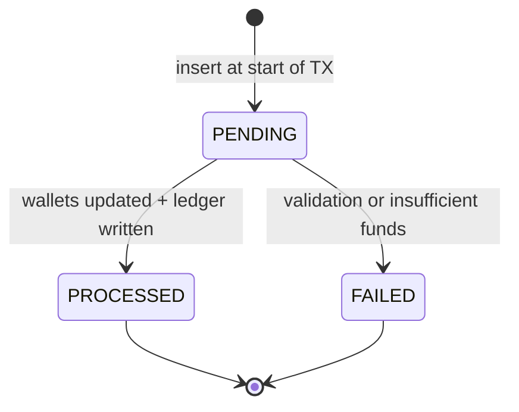

# System design — Wallet Transfer Service

## Problem statement

Clients need to move funds between wallets reliably over an unreliable network. Retries and duplicate HTTP requests must not double-charge. The service must provide an auditable financial record (double-entry ledger) and clear transfer outcomes.

## API contract

### `POST /transfers`

Creates a transfer request. **Exactly-once processing** is defined relative to `idempotencyKey`: the system executes the financial side effects at most once; retries receive the same result.

**Request headers**

| Header | Required | Description |
|--------|----------|-------------|
| `Idempotency-Key` | Yes* | Opaque string, max 128 chars (*or field in body — pick one; document in OpenAPI) |
| `Content-Type` | Yes | `application/json` |

**Request body (JSON)**

```json
{
  "idempotencyKey": "550e8400-e29b-41d4-a716-446655440000",
  "fromWalletId": "w_src_01",
  "toWalletId": "w_dst_02",
  "amount": 10050,
  "currency": "INR"
}
```

| Field | Type | Rules |
|-------|------|-------|
| `idempotencyKey` | string | Required, unique per deployment scope |
| `fromWalletId` | string | Required, must exist |
| `toWalletId` | string | Required, ≠ `fromWalletId` |
| `amount` | int64 | Required, > 0, minor units (paise) |
| `currency` | string | Required, 3-letter ISO; must match both wallets |

**Success response `201 Created`**

```json
{
  "id": "tr_abc123",
  "status": "PROCESSED",
  "fromWalletId": "w_src_01",
  "toWalletId": "w_dst_02",
  "amount": 10050,
  "currency": "INR",
  "idempotencyKey": "550e8400-e29b-41d4-a716-446655440000",
  "createdAt": "2026-09-28T12:00:00Z",
  "processedAt": "2026-09-28T12:00:01Z"
}
```

**Idempotent replay `200 OK` or `201 Created`**

Return the **same JSON body** and stable `id` as the first successful processing. HTTP status may be documented as always `200` on replay for simplicity.

**Error responses**

| Status | Condition |
|--------|-----------|
| `400` | Malformed JSON, missing fields |
| `404` | Wallet not found |
| `409` | Insufficient balance; or same idempotency key with **different** request fingerprint |
| `422` | Business rule violation (same wallet, zero amount) |
| `500` | Unexpected DB error (no partial ledger) |

### `GET /transfers/{id}`

Returns current transfer row (any terminal or in-flight state). `404` if unknown.

### `GET /health`

`200` with `{ "status": "ok" }`.

---

## Data model (PostgreSQL)

### `wallets`

| Column | Type | Notes |
|--------|------|-------|
| `id` | `TEXT` PK | e.g. UUID or prefixed id |
| `currency` | `CHAR(3)` NOT NULL | |
| `balance` | `BIGINT NOT NULL DEFAULT 0` | Minor units; **derived cache** — ledger is audit source |
| `version` | `BIGINT NOT NULL DEFAULT 0` | Optional optimistic lock |
| `created_at` | `TIMESTAMPTZ` | |
| `updated_at` | `TIMESTAMPTZ` | |

**Constraints:** `balance >= 0` (if overdraft disallowed).

**Indexes:** PK only for v1.

### `transfers`

| Column | Type | Notes |
|--------|------|-------|
| `id` | `TEXT` PK | |
| `idempotency_key` | `TEXT NOT NULL` | |
| `from_wallet_id` | `TEXT NOT NULL` FK → wallets |
| `to_wallet_id` | `TEXT NOT NULL` FK → wallets |
| `amount` | `BIGINT NOT NULL` | |
| `currency` | `CHAR(3) NOT NULL` | |
| `status` | `TEXT NOT NULL` | `PENDING`, `PROCESSED`, `FAILED` |
| `failure_reason` | `TEXT` | Nullable, set when `FAILED` |
| `created_at` | `TIMESTAMPTZ` | |
| `updated_at` | `TIMESTAMPTZ` | |
| `processed_at` | `TIMESTAMPTZ` | Set when terminal success |

**Constraints:**

- `CHECK (status IN ('PENDING','PROCESSED','FAILED'))`
- `CHECK (amount > 0)`
- `CHECK (from_wallet_id <> to_wallet_id)`
- `UNIQUE (idempotency_key)` — global scope for assignment

**Indexes:**

- `UNIQUE (idempotency_key)` (constraint)
- `INDEX (from_wallet_id, created_at DESC)` for support queries

### `ledger_entries`

Immutable append-only lines (no UPDATE/DELETE in application code).

| Column | Type | Notes |
|--------|------|-------|
| `id` | `BIGSERIAL` PK | |
| `transfer_id` | `TEXT NOT NULL` FK → transfers | |
| `wallet_id` | `TEXT NOT NULL` FK → wallets | |
| `entry_type` | `TEXT NOT NULL` | `DEBIT` or `CREDIT` |
| `amount` | `BIGINT NOT NULL` | Always positive magnitude |
| `currency` | `CHAR(3) NOT NULL` | |
| `created_at` | `TIMESTAMPTZ` | |

**Constraints:**

- `CHECK (entry_type IN ('DEBIT','CREDIT'))`
- `CHECK (amount > 0)`
- `UNIQUE (transfer_id, entry_type, wallet_id)` — exactly one debit and one credit per transfer

**Double-entry rules**

1. For each `PROCESSED` transfer, insert **exactly two** rows: DEBIT on `from_wallet_id`, CREDIT on `to_wallet_id`, same `amount` and `currency`.
2. Sum of signed amounts per transfer: `-amount + amount = 0`.
3. Wallet `balance` after transfer must equal prior balance ± amount (debit decreases source, credit increases dest).
4. No ledger rows for `FAILED` transfers (recommended) — keeps audit trail unambiguous.

### `idempotency_records`

Tracks in-flight and completed idempotent operations (may mirror Stripe-style pattern).

| Column | Type | Notes |
|--------|------|-------|
| `idempotency_key` | `TEXT` PK | |
| `request_fingerprint` | `TEXT NOT NULL` | SHA-256 of canonical request JSON |
| `status` | `TEXT NOT NULL` | `IN_PROGRESS`, `COMPLETED`, `FAILED` |
| `transfer_id` | `TEXT` | FK when known |
| `response_status` | `INT` | HTTP status to replay |
| `response_body` | `JSONB` | Serialized success/error body |
| `created_at` | `TIMESTAMPTZ` | |
| `expires_at` | `TIMESTAMPTZ` | Optional TTL for cleanup job |

**Indexes:** PK on `idempotency_key`.

**Note:** `transfers.idempotency_key` UNIQUE duplicates the key for query convenience; alternatively use only `idempotency_records` and drop column on transfers — pick one source of truth in implementation.

---

## Transfer state machine



| State | Meaning | Side effects |
|-------|---------|--------------|
| `PENDING` | Row created inside open transaction | None visible outside TX until commit |
| `PROCESSED` | Success | Balances changed; 2 ledger entries |
| `FAILED` | Business failure | No balance change; no ledger |

**Idempotency interaction:** On duplicate request, do **not** create a second transfer; read completed `idempotency_records` / existing `transfers` by key and return stored response.

---

## Idempotency design

### Storage

1. Begin transaction.
2. `INSERT INTO idempotency_records (idempotency_key, ..., status) VALUES (..., 'IN_PROGRESS')`  
   - On `unique_violation`: roll to savepoint or abort and **select** existing record.
3. If existing `COMPLETED`: return `response_body` (short-circuit).
4. If existing `IN_PROGRESS` (another request in flight): wait/retry or return `409` with `Retry-After` (document choice; assignment-friendly: block on row lock via `SELECT ... FOR UPDATE` on idempotency row).
5. If new: proceed with transfer workflow; on success update record to `COMPLETED` with response snapshot; commit.

### Duplicate detection

- **Primary:** `UNIQUE(idempotency_key)` on `transfers` and/or `idempotency_records`.
- **Conflict:** Same key, different `request_fingerprint` → `409 Conflict` (prevents key reuse abuse).

### Preventing duplicate side effects

All of the following must commit in **one database transaction**:

- Idempotency row transition to `COMPLETED`
- Transfer `PROCESSED`
- Wallet balance updates
- Ledger inserts

If the transaction rolls back, client retry may safely re-enter.

---

## Concurrency strategy

### Recommended approach (assignment default)

| Mechanism | Use |
|-----------|-----|
| Isolation | PostgreSQL default **`READ COMMITTED`** |
| Wallet updates | **`SELECT balance FROM wallets WHERE id = $1 FOR UPDATE`** on source (and destination for symmetry) |
| Idempotency | Insert-first with unique constraint; handle conflict in application |
| Transaction boundary | One `BEGIN` … `COMMIT` per `POST /transfers` attempt |

**Why row locks over optimistic-only?**

- Transfer hot-spot is a single wallet balance; `FOR UPDATE` serializes debits deterministically.
- Optimistic `version` column is viable but produces more retries under load; document if chosen.

**Why not `SERIALIZABLE` globally?**

- Higher abort rate; explicit row locks are sufficient for two-row wallet updates.

### Race scenarios

| Scenario | Expected behavior |
|----------|-------------------|
| Two POSTs, same idempotency key | One execution; other gets stored response |
| Two POSTs, different keys, same source wallet, combined amount > balance | One succeeds; other `FAILED` / `409` insufficient funds |
| POST retry after timeout | Safe retry; no double debit |

### Deadlocks

Lock wallets in **consistent order** (e.g. sort `from_wallet_id`, `to_wallet_id` lexicographically) when both could be locked in cross-transfers.

---

## Layered architecture

```
HTTP (Gin)
  → handler.TransferHandler     # bind, status codes, idempotency header
  → service.TransferService     # orchestration, BeginTx
  → repository.*                # SQL, locking primitives
  → domain                      # Transfer, Wallet, Money, errors
```

**Rules**

- Handlers: no SQL.
- Service: owns transaction scope and domain invariants.
- Repository: parameterized queries only; expose `WithTx(tx)` or accept `Querier` interface.
- Domain: pure functions for validation (amount > 0, currency match).

**Alignment with monorepo:** Production services use `handlers` + `controllers`; this assignment should use **handler/service/repository** naming to match clean-architecture rubric.

---

## Failure modes & consistency

| Failure | Consistency guarantee |
|---------|------------------------|
| Crash after commit | Transfer `PROCESSED`; client retry returns same result |
| Crash before commit | No durable transfer or balances; client retries |
| Insufficient funds | `FAILED` transfer or no row + error — **no partial debit** |
| FK violation | Rollback; 404 wallet |
| Unique idempotency conflict | Read and return original |

**Ledger vs balance:** Optionally verify periodically: `wallet.balance == SUM(credits) - SUM(debits)` from `ledger_entries` (reconciliation job — stretch).

---

## Observability

- **Logging:** `transfer_id`, `idempotency_key`, `from`, `to`, `amount`, `status`, `duration_ms` (never log full PAN/secrets).
- **Tracing:** OpenTelemetry middleware (stretch).
- **Health:** DB ping in `/health` (readiness).

---

## Testing strategy

| Layer | What to test |
|-------|----------------|
| Unit (`domain`) | Money validation, status transitions, fingerprint hashing |
| Unit (`service`) | Mock repository: insufficient funds, success path |
| Integration (Postgres) | Full `POST /transfers`; ledger row count; balance assertions |
| Idempotency | Sequential + parallel duplicate keys (20–50 goroutines) |
| Concurrency | Two transfers draining same balance |
| Failure injection | Rollback when ledger insert fails (mock repo or subtransaction) |

**Commands (target)**

```bash
go test ./... -count=1
go test ./tests/integration/... -tags=integration -race -count=1
```

**Monorepo note:** `wallet_service_be` uses in-memory SQLite for tests; this assignment should use **real Postgres** (testcontainers or compose) because locking semantics matter.

---

## Security (minimal)

- No auth in v1 unless stretch.
- Validate input sizes; reject negative amounts.
- Use `pgx` with bound parameters only.

---

## Comparison to `wallet_service_be`

| Aspect | `wallet_service_be` | This assignment |
|--------|---------------------|-----------------|
| Balance type | `DOUBLE PRECISION` | `BIGINT` minor units |
| Audit | `wallet_transactions` list | Double-entry `ledger_entries` |
| Idempotency | Payment verify flows | First-class `idempotencyKey` on transfers |

Keep implementations separate to avoid conflating assignment review with production payment code.
