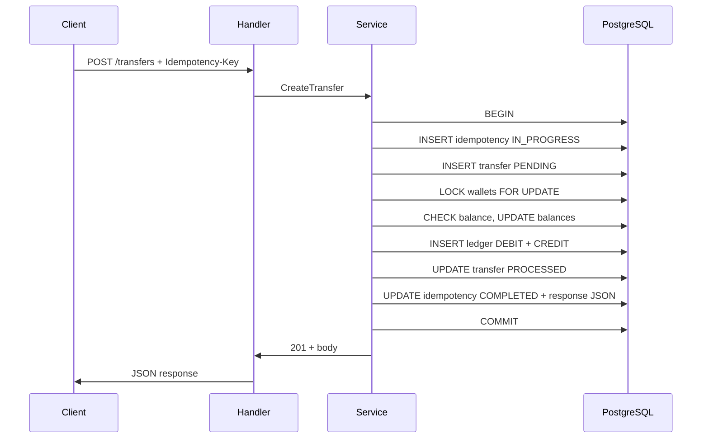

# Wallet Transfer Service — Project Guide

This document explains the **wallet transfer service** end to end: how the repository is organized, why it is organized that way, what it does, how the main mechanisms work, and how you might evolve it in production.

**Audience:** New developers, reviewers, and anyone preparing a demo or PR without reading every source file first.

**Related docs**

| Document | Use when |
|----------|----------|
| [DESIGN.md](./DESIGN.md) | API contract, schema detail, failure modes |
| [PLAN.md](./PLAN.md) | How the work was phased |
| [IMPLEMENTATION_NOTES.md](./IMPLEMENTATION_NOTES.md) | Short PR-oriented summary |
| [README.md](../README.md) | Commands to run and curl examples |

---

## 1. What this service does

The service moves money **from one wallet to another** over HTTP. It is built for **financial correctness** under real-world problems:

- Clients **retry** failed requests.
- Networks deliver **duplicate** requests.
- Many transfers can hit the **same wallet** at once.

The service answers with:

| Guarantee | Meaning |
|-----------|---------|
| **Idempotent API** | Same `idempotencyKey` → same HTTP body and outcome; money moves at most once. |
| **Atomic transfer** | Balance updates and ledger rows succeed or fail together in one database transaction. |
| **Double-entry ledger** | Every successful transfer creates exactly one **DEBIT** and one **CREDIT** for the same amount. |
| **Explicit transfer state** | Each transfer is `PENDING`, then `PROCESSED` or `FAILED`. |
| **Safe concurrency** | Row locks and ordered locking prevent double-spend and deadlocks. |

Amounts are stored as **integers in minor units** (e.g. paise for INR), never floating point.

---

## 2. Project structure

### 2.1 Directory tree

```text
wallet_transfer_service/
├── cmd/
│   └── server/
│       └── main.go              # Process entry: config, DB pool, HTTP server, graceful shutdown
├── internal/
│   ├── config/
│   │   └── config.go            # PORT, DATABASE_URL, LOG_LEVEL, ENV from environment
│   ├── domain/
│   │   ├── money.go             # Money type, amount validation
│   │   ├── transfer_status.go   # PENDING / PROCESSED / FAILED and transition rules
│   │   ├── ledger.go            # DEBIT / CREDIT entry types
│   │   ├── entities.go          # Wallet, Transfer, LedgerEntry, IdempotencyRecord
│   │   ├── idempotency.go       # Request fingerprint for conflict detection
│   │   └── errors.go            # ValidationError, ErrInsufficientFunds, etc.
│   ├── handler/
│   │   ├── routes.go            # Gin route registration
│   │   ├── transfer.go          # POST /transfers, GET /transfers/:id
│   │   ├── health.go            # GET /health (optional DB ping)
│   │   └── deps.go              # Handler dependencies (service, DB)
│   ├── middleware/
│   │   ├── request_id.go        # X-Request-ID for tracing
│   │   └── access_log.go        # Structured access logs
│   ├── service/
│   │   ├── transfer.go          # CreateTransfer orchestration (single DB transaction)
│   │   └── response.go          # JSON mapping for transfer responses
│   └── repository/
│       ├── ports.go             # Interfaces: Wallet, Transfer, Ledger, Idempotency
│       └── postgres/
│           ├── pool.go          # Connection pool setup
│           ├── store.go         # Bundles repositories for wiring
│           ├── wallet.go        # Balance read/update, FOR UPDATE
│           ├── transfer.go      # Transfer CRUD and status updates
│           ├── ledger.go        # Insert ledger lines
│           └── idempotency.go   # Idempotency claim and completion
├── migrations/
│   ├── 000001_phase0_placeholder.*
│   ├── 000002_init_schema.*     # wallets, transfers, ledger_entries, idempotency_records
│   └── 000003_seed_demo_wallets.*  # wallet_1, wallet_2 for local demos
├── tests/
│   └── integration/             # Postgres tests (build tag: integration)
├── docs/                        # Design, plan, this guide, PR notes
├── docker-compose.yml           # Local Postgres on port 5433
├── Makefile                     # run, test, migrate, docker
├── .env.example
└── go.mod
```

### 2.2 Layer responsibilities

```text
  Client (curl / mobile / other service)
           │
           ▼
  ┌─────────────────────┐
  │  handler (HTTP)     │  Parse JSON, idempotency header, map errors → status codes
  └──────────┬──────────┘
             │
             ▼
  ┌─────────────────────┐
  │  service            │  Business workflow: idempotency, transfer state, one transaction
  └──────────┬──────────┘
             │
             ▼
  ┌─────────────────────┐
  │  repository         │  SQL only; no business rules
  │  (postgres impl)    │
  └──────────┬──────────┘
             │
             ▼
       PostgreSQL
```

| Layer | Should do | Should not do |
|-------|-----------|----------------|
| **handler** | Validation of transport (JSON shape), call service, write HTTP response | SQL, balance math, idempotency logic |
| **service** | Orchestrate steps, begin/commit transaction, interpret domain errors | Gin-specific types, raw SQL strings |
| **domain** | Types, invariants, fingerprints, status rules | Database I/O |
| **repository** | Persist and load entities | Decide if a transfer is allowed |

---

## 3. Why this structure

### 3.1 Clean / layered architecture

The assignment asks for **handler → service → repository → domain**. That split is deliberate:

1. **Testability** — Domain rules and service flows can be tested with integration tests against Postgres; handlers can be tested with Gin’s test harness without a full transfer.
2. **Clarity** — Financial logic lives in one place (`internal/service/transfer.go`), not scattered in HTTP handlers.
3. **Swapability** — `repository/ports.go` defines interfaces. Today the implementation is `postgres/`; tomorrow you could add a mock for unit tests or a different store without changing HTTP code.
4. **Alignment with PowerXchange** — Sibling services (`user_service_be`, `order_service_be`) use Gin and layered handlers; this project follows the same ecosystem while using **explicit SQL** for ledger auditing instead of hiding money moves behind an ORM.

### 3.2 `internal/` package

Go’s `internal/` convention prevents other modules from importing implementation details. Only `cmd/server` is the public entrypoint.

### 3.3 SQL migrations in `migrations/`

Schema is **versioned** and applied with `golang-migrate`. That matches production practice: reviewers can read `000002_init_schema.up.sql` and see constraints (unique idempotency key, ledger uniqueness per transfer) without running the app.

### 3.4 Integration tests in `tests/integration/`

Tests that need real **locking behavior** run behind `-tags=integration` so `go test ./...` stays fast in CI without Docker. Concurrency and idempotency are validated against Postgres, not mocks.

### 3.5 Separate folder from `wallet_service_be`

Production wallet code in the monorepo handles Razorpay and platform flows with different data models. This assignment is **isolated** so candidates can demonstrate ledger and idempotency without risking production services.

---

## 4. Features (assignment mapping)

| Assignment requirement | Implementation |
|------------------------|----------------|
| `POST /transfers` | `internal/handler/transfer.go` → `TransferService.CreateTransfer` |
| Idempotent requests | `idempotency_records` + unique `transfers.idempotency_key` |
| Wallet balances | `wallets.balance` updated in same transaction as ledger |
| Double-entry ledger | Two rows per `PROCESSED` transfer: DEBIT source, CREDIT destination |
| States PENDING → PROCESSED / FAILED | `transfers.status` + service updates |
| Concurrency safety | `SELECT … FOR UPDATE` on wallets; lexicographic lock order |
| PostgreSQL persistence | Schema in migrations; `pgx` pool |
| Layered architecture | As in section 2 |
| Tests | Unit: domain/handler; integration: transfer, idempotency, concurrency |

### 4.1 HTTP API surface

| Method | Path | Purpose |
|--------|------|---------|
| `GET` | `/health` | Liveness; includes DB ping when `DATABASE_URL` is set |
| `POST` | `/transfers` | Create or replay a transfer |
| `GET` | `/transfers/:id` | Read transfer by id (any status) |

**Idempotency key** — Send via JSON `idempotencyKey` or header `Idempotency-Key` (header wins if both are present).

**Amount** — Integer **minor units** (e.g. `10050` = ₹100.50).

### 4.2 Demo data

After migrations, seeded wallets:

| Wallet | Currency | Balance (minor units) |
|--------|----------|------------------------|
| `wallet_1` | INR | 100000 (₹1,000.00) |
| `wallet_2` | INR | 50000 (₹500.00) |

---

## 5. How it works

### 5.1 End-to-end: successful transfer



**Single transaction** — If any step fails before commit, `ROLLBACK` drops partial updates. No orphan ledger rows on success path failure mid-flight.

### 5.2 Idempotency

**Goal:** Exactly-once **effects** with **at-least-once** HTTP delivery.

1. **Fingerprint** — Canonical hash of `fromWalletId`, `toWalletId`, `amount`, `currency`. Same key + different body → **409 Conflict**.
2. **Claim** — `INSERT` into `idempotency_records` with status `IN_PROGRESS`.
3. **Duplicate** — Unique violation on `idempotency_key` → `SELECT … FOR UPDATE` on existing row.
4. **Replay** — If status is `COMPLETED`, return stored `response_body` and status (first success often **201**, replays **200**).
5. **Concurrent duplicates** — Second request blocks on row lock until the first transaction commits, then reads the completed snapshot.

The `transfers` table also has `UNIQUE(idempotency_key)` so two transfer rows cannot exist for one key.

### 5.3 Transfer state machine

```text
                    ┌──────────┐
                    │ PENDING  │
                    └────┬─────┘
           success       │        business failure
              ┌──────────┼──────────┐
              ▼                     ▼
       ┌────────────┐        ┌──────────┐
       │ PROCESSED  │        │  FAILED  │
       └────────────┘        └──────────┘
```

- **PROCESSED** — Balances changed; exactly two ledger entries exist.
- **FAILED** — e.g. insufficient funds or missing wallet; **no** ledger entries; idempotency still **completed** with stored response so retries get the same outcome.

### 5.4 Double-entry ledger

For transfer `T1` of amount `100` from `wallet_1` to `wallet_2`:

| wallet_id | transfer_id | type   | amount |
|-----------|-------------|--------|--------|
| wallet_1  | T1          | DEBIT  | 100    |
| wallet_2  | T1          | CREDIT | 100    |

**Rules enforced:**

- DB: `UNIQUE(transfer_id, entry_type, wallet_id)` prevents duplicate debits/credits.
- Application: inserts only after balance checks, only when moving to `PROCESSED`.

`wallets.balance` is a **cached aggregate** for fast reads; the ledger is the **audit trail**. In a larger system you could reconcile balance vs sum of ledger periodically.

### 5.5 Concurrency

| Technique | Role |
|-----------|------|
| **READ COMMITTED** | Postgres default; explicit locks provide strong per-wallet serialization |
| **`FOR UPDATE` on wallets** | Two transfers debiting the same wallet serialize on the source row |
| **Lexicographic lock order** | When locking both wallets, always lock smaller `id` first → avoids deadlock on A→B and B→A |
| **Idempotency row lock** | Parallel retries with same key serialize on one idempotency record |

Integration tests cover parallel idempotency (many goroutines, one transfer) and competing debits from one wallet.

### 5.6 Failure and HTTP mapping

| Situation | Transfer status | Ledger | Typical HTTP |
|-----------|-----------------|--------|--------------|
| Success | PROCESSED | 2 rows | 201 |
| Insufficient funds | FAILED | none | 409 |
| Wallet not found | FAILED | none | 404 |
| Validation (same wallet, bad amount) | — (no commit path) | none | 422 |
| Idempotency body mismatch | — | none | 409 |

Failed transfers still **complete** idempotency with a stored JSON body so clients can retry safely and see the same result.

### 5.7 Observability (current)

- **Structured logs** (`slog`) with `transfer_id`, `idempotency_key` on success/failure.
- **Request ID** middleware for correlating access logs.
- **Health** endpoint for orchestrators (Kubernetes, etc.).

Metrics and OpenAPI are optional stretch items (see [PLAN.md](./PLAN.md)).

---

## 6. Database model (quick reference)

```text
  wallets ─────┬──────────────────────────────────┐
               │                                  │
               ▼                                  ▼
         transfers ◄─────────────────── idempotency_records
               │
               ▼
        ledger_entries
```

| Table | Purpose |
|-------|---------|
| `wallets` | Current balance per wallet + `version` for optimistic updates |
| `transfers` | Business record of each transfer attempt/outcome |
| `ledger_entries` | Immutable-style lines for PROCESSED transfers |
| `idempotency_records` | Dedup key → stored HTTP response for replay |

Important constraints: non-negative balance, positive amount, distinct from/to wallets, unique idempotency key on transfers and idempotency table.

---

## 7. Running and verifying

### 7.1 Local setup

```bash
cd wallet_transfer_service
cp .env.example .env
make docker-up
make migrate-up
make run
```

### 7.2 Tests

```bash
make test                 # No database
make test-integration     # Requires Postgres (compose on :5433)
```

### 7.3 Manual API check

See [README.md](../README.md) for curl examples: happy path, idempotent replay, insufficient funds, `GET` by id.

---

## 8. How to scale in the future

This service is a **focused assignment**, not a full production platform. The structure still points to common scale paths.

### 8.1 Application tier

| Step | Approach |
|------|----------|
| **More throughput** | Run **multiple stateless** API instances behind a load balancer; no in-memory session state. |
| **Connection pooling** | Use PgBouncer (or RDS Proxy) between many app pods and Postgres. |
| **Read scaling** | `GET /transfers/:id` and future wallet/history APIs can use **read replicas**; writes stay on primary. |
| **Hot wallets** | Shard by `wallet_id` or route high-volume wallets to dedicated partitions; keep **per-wallet serialization** (locks or single-thread partition consumer). |

### 8.2 Data and correctness

| Step | Approach |
|------|----------|
| **Ledger-first reporting** | Stream `ledger_entries` to analytics (CDC, Debezium) without loading OLTP. |
| **Balance reconciliation** | Periodic job: `balance` vs sum(ledger); alert on drift. |
| **Stronger isolation** | Rarely needed if locks are correct; `SERIALIZABLE` is a heavier alternative. |
| **Idempotency TTL** | Add cleanup job for old `idempotency_records` (`expires_at` column exists for this). |
| **Stuck IN_PROGRESS** | Background sweeper for crashed workers mid-transaction (assignment rolls back on process death; production needs explicit policy). |

### 8.3 Async and integrations

| Step | Approach |
|------|----------|
| **Outbox pattern** | After commit, insert into `outbox` table; worker publishes events (transfer completed) to Kafka/SNS. |
| **Async settlement** | Keep synchronous path for balance check; notify other systems asynchronously. |
| **Multi-tenant** | Scope `idempotency_key` with `client_id`; composite unique index. |

### 8.4 Operations

| Step | Approach |
|------|----------|
| **Metrics** | Prometheus: transfer latency histogram, count by status, idempotency replays. |
| **Tracing** | OpenTelemetry from handler through DB spans. |
| **CI** | GitHub Actions: `go test`, integration job with service container Postgres. |
| **API docs** | Publish OpenAPI from handler structs or `api/openapi.yaml`. |

### 8.5 Optional product APIs (stretch)

- `GET /wallets/:id` — balance + recent ledger tail.
- Transfer list/history with cursor pagination on `transfers.created_at`.

These are listed as stretch goals in [PLAN.md](./PLAN.md).

---

## 9. Mental model for reviewers

When explaining this project in an interview or PR discussion, emphasize three pillars:

1. **One transaction boundary** — Idempotency claim, transfer row, wallet updates, ledger pair, and idempotency completion commit together (or roll back).
2. **Idempotency is not optional** — Stored responses make retries safe; fingerprint prevents key reuse abuse.
3. **Concurrency is explicit** — Locks and ordering are chosen and tested, not assumed from “Postgres is ACID.”

For a one-page PR summary, use [IMPLEMENTATION_NOTES.md](./IMPLEMENTATION_NOTES.md).

---

## 10. Glossary

| Term | Meaning |
|------|---------|
| **Minor units** | Smallest currency unit (paise, cents); stored as `BIGINT`. |
| **Idempotency key** | Client-generated unique string for one logical operation. |
| **Fingerprint** | Hash of transfer fields to detect same key, different intent. |
| **Double-entry** | Every movement has equal debit and credit legs. |
| **FOR UPDATE** | Row-level lock held until transaction ends. |

---

*Last updated to reflect Phases 0–7 implementation in this repository.*
